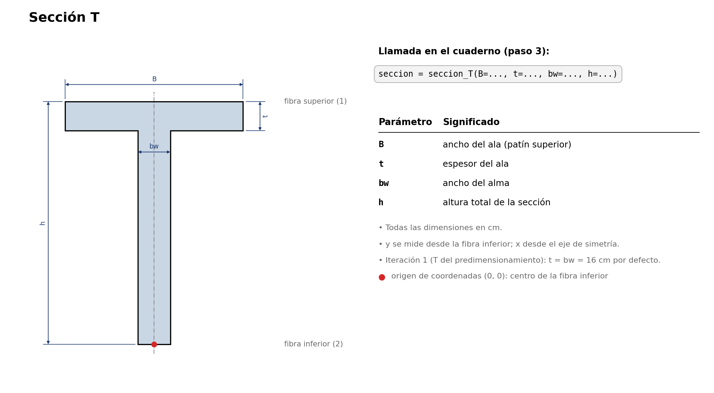
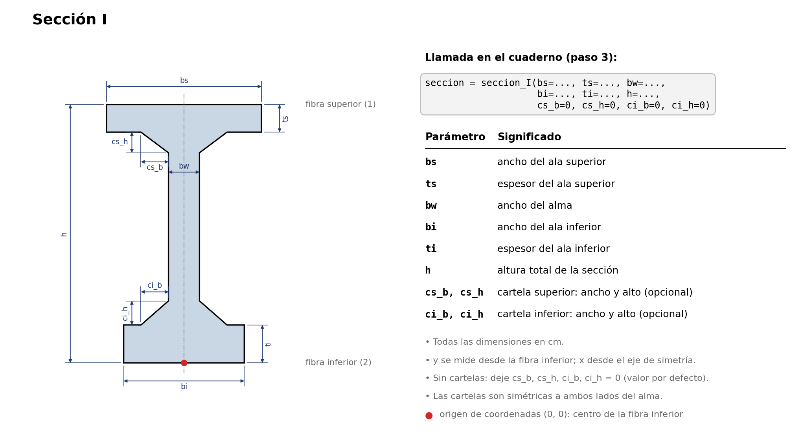
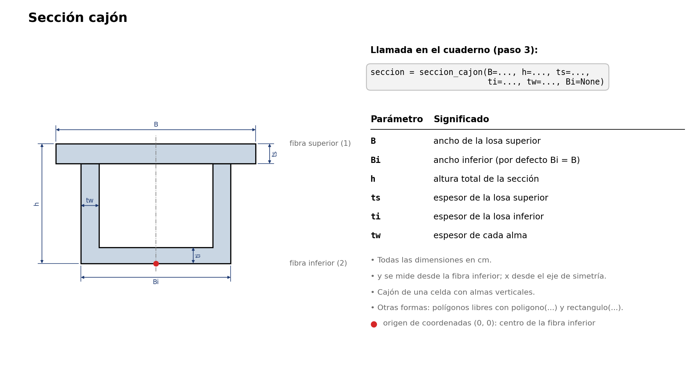

# Diseño de viga de hormigón presforzado

Calculadora en Python y Jupyter para diseñar a flexión una viga presforzada simplemente apoyada de un puente. El cálculo va paso a paso:

1. Cargas del tablero.
2. Predimensionamiento.
3. Iteraciones de la sección transversal.
4. Diseño del presfuerzo.
5. Cable resultante, curvas límite y torones.

Al final se genera una memoria de cálculo en LaTeX/PDF con todo el desarrollo.

## Estructura

```
├── Cargas.ipynb                    # 1) Cálculo de cargas por viga  →  Datos/cargas.json
├── Diseno_Viga_Presforzada.ipynb   # 2) Diseño de la viga, iteraciones e informe
├── Core/                           # Motores de cálculo (módulos .py)
│   ├── cargas.py                   #    tablero, losa, aceras, asfalto, postes y pasamanos
│   ├── presforzado.py              #    sección, propiedades, presfuerzo, esfuerzos, cable, torones
│   ├── iteraciones.py              #    registro persistente de iteraciones
│   └── generar_informe.py          #    memoria de cálculo LaTeX/PDF
├── Datos/cargas.json               # Cargas que pasan del cuaderno de cargas al de diseño
├── Iteraciones/iteraciones.json    # Registro de iteraciones de la sección
├── Instructivo/                    # Nomenclatura de las cotas de las secciones T, I y cajón
├── Figuras/                        # Todas las figuras generadas
└── Informe/                        # Informe_Viga_Presforzada.tex y .pdf
```

Los cuadernos solo llaman a las funciones de `Core/`; los datos se modifican en la celda **1. Datos** de cada cuaderno.

## Ejemplo incluido

El repositorio trae un ejemplo resuelto: un puente de L = 35 m con 3 vigas y f'c = 420 kg/cm².

| Iteración | Sección | Q | Resultado |
|---|---|---|---|
| 1 | T del predimensionamiento (B = 40, t = 16, b_w = 16, h = 230) | 0.379 | No cumple |
| 2 | I (b_s = 45, t_s = 16, b_w = 16, b_i = 80, t_i = 21, h = 230) | 0.489 | Cumple, **adoptada** |

La sección adoptada lleva 4 torones y el diseño es válido. Los cuadernos se publican con sus resultados, y la memoria de cálculo completa está en [`Informe/Informe_Viga_Presforzada.pdf`](Informe/Informe_Viga_Presforzada.pdf).

## Nomenclatura de las secciones

La carpeta [`Instructivo/`](Instructivo/) muestra qué es cada cota en las funciones de sección. Las mismas láminas están juntas en [`Instructivo_Secciones.pdf`](Instructivo/Instructivo_Secciones.pdf).

| Sección T | Sección I | Sección cajón |
|---|---|---|
|  |  |  |

## Instalación

### 1. Programas necesarios

| Programa | Para qué | Dónde |
|---|---|---|
| **Python 3.10 o superior** | Ejecutar los cálculos | [python.org/downloads](https://www.python.org/downloads/). En Windows, marca **"Add python.exe to PATH"** al instalar. |
| **VS Code** + extensiones **Python** y **Jupyter** | Abrir y ejecutar los cuadernos | [code.visualstudio.com](https://code.visualstudio.com/) |
| **Git** (opcional) | Clonar el repositorio | [git-scm.com](https://git-scm.com/). Sin Git, usa *Code → Download ZIP* en GitHub. |
| **Tectonic** (opcional) | Compilar el informe a PDF | [tectonic-typesetting.github.io](https://tectonic-typesetting.github.io/). Ver el paso 4. |

En lugar de VS Code también puedes usar JupyterLab, que se instala en el paso 3.

### 2. Descargar el proyecto

```bash
git clone https://github.com/racalleo/Diseno_Viga_Presforzada.git
cd Diseno_Viga_Presforzada
```

### 3. Crear un entorno e instalar las librerías

Se recomienda un entorno virtual, para no mezclar estas librerías con otros proyectos. Crea el entorno:

```bash
python -m venv .venv
```

Actívalo en Windows (PowerShell):

```bash
.venv\Scripts\Activate.ps1
```

Actívalo en macOS o Linux:

```bash
source .venv/bin/activate
```

Instala las librerías del proyecto (`numpy`, `matplotlib`, `ipywidgets` y `jupyter`):

```bash
pip install -r requirements.txt
```

Si PowerShell no deja activar el entorno, ejecuta una vez:

```bash
Set-ExecutionPolicy -Scope CurrentUser RemoteSigned
```

### 4. Tectonic (solo para el PDF del informe)

Sin Tectonic, todo funciona igual y el informe se genera como `.tex`, que puede compilarse en Overleaf (ver [Informe LaTeX](#informe-latex)). Para obtener el PDF directamente:

- **Windows:** descarga el `.zip` de [las versiones de Tectonic](https://github.com/tectonic-typesetting/tectonic/releases), extrae `tectonic.exe` en una carpeta y agrega esa carpeta a la variable de entorno `PATH`.
- **macOS:** `brew install tectonic`.
- **Linux:** usa el paquete de tu distribución o el instalador de la página de Tectonic.

Comprueba la instalación con este comando:

```bash
tectonic --version
```

La primera compilación descarga los paquetes de LaTeX que necesita, así que requiere internet y tarda un poco más.

### 5. Abrir los cuadernos

1. En VS Code, abre la **carpeta raíz del proyecto** con *File → Open Folder*. Las rutas (`Core/`, `Datos/`, `Iteraciones/`…) son relativas a ella.
2. Abre `Cargas.ipynb` y elige el kernel del entorno `.venv` arriba a la derecha (*Select Kernel*).
3. Ejecuta **Run All**.

Con JupyterLab, ejecuta `jupyter lab` desde la carpeta raíz.

## Uso

### 1. Cargas: `Cargas.ipynb`

Todos los datos van en la celda **1. Datos Iniciales**:

- **Geometría:** luz, número de vigas, separación S y voladizo.
- **Elementos:** espesores de losa y asfalto, acera con alivianamientos, postes y pasamanos.
- **Materiales y carga viva:** pesos específicos y carga viva q_L.

Después, *Run All*. El cuaderno desarrolla cada carga:

| Paso | Carga | Distribución |
|---|---|---|
| 2 | Losa | Área tributaria de la viga (ancho S) |
| 3 | Aceras con alivianamiento | Peso total ÷ número de vigas |
| 4 | Carpeta asfáltica | Área tributaria de la viga (ancho S) |
| 5 | Postes y pasamanos | Peso total ÷ número de vigas |

El paso 6 guarda los resultados en `Datos/cargas.json`.

### 2. Diseño: `Diseno_Viga_Presforzada.ipynb`

1. **Datos de entrada:** las cargas se leen de `Datos/cargas.json` (`usar_json = True`) o se escriben a mano en `cargas_manual`. Aquí también van f'c, pérdidas, d₂, γc, etc.
2. **Predimensionamiento:** de él sale la sección T inicial (iteración 1). Su altura h es el promedio redondeado a 5 cm, y por defecto t = b_w = 16 cm.
3. **Sección transversal:** la sección de la iteración actual. Puede ser T, I, cajón o cualquier polígono.
4. **Propiedades:** A, c₁, c₂, I, S₁, S₂, k₁, k₂.
5. **Momentos:** M_G y M_T en L/2.
6. **Presfuerzo:** F₀, F y e, con excentricidad restringida o no restringida.
7. **Esfuerzos y verificación:** esfuerzos en las etapas inicial y final, verificados contra los admisibles.
8. **Eficiencia:** Q = (k₁ + k₂)/h.
9. **Registro de iteraciones:** el botón **Guardar iteración** agrega la sección actual a `Iteraciones/iteraciones.json` y a la tabla resumen. Si la sección no cumple, el cuaderno se detiene aquí.
10. **Cable resultante:** cable parabólico y curvas límite.
11. **Torones:** se definen en modo manual y se verifica la resultante.
12. **Validez del diseño e informe LaTeX/PDF.**

#### Cómo iterar

1. Ejecutar todo; la primera iteración es la sección T del predimensionamiento.
2. Pulsar **Guardar iteración**.
3. Modificar la sección en el paso 3 y volver a ejecutar.
4. Repetir hasta que la sección cumpla. La última iteración que cumple es la sección adoptada.

**Para un diseño nuevo:**

- Borra o comenta la línea `seccion = seccion_I(...)` del ejemplo en el paso 3.
- Vacía el registro con `reg.nuevo()` (celda de opciones del paso 10) o borrando `Iteraciones/iteraciones.json`.

## Criterios

- **Unidades:** kg, cm (sección), m (luz), kg/m, kg·m, kg/cm².
- **Signos:** compresión negativa. La tracción admisible es 0.
- **Resistencias y admisibles:**
  - f'ci = 0.70 f'c.
  - Admisible inicial: −0.60 f'ci.
  - Admisible final: −0.45 f'c.
- **Factor de pérdidas:** α = 100 / (100 − pérdidas %).
- **Eficiencia:** se recomienda 0.45 ≤ Q ≤ 0.55.

## Informe LaTeX

`generar_informe.py` escribe `Informe/Informe_Viga_Presforzada.tex`, guarda sus figuras en `Figuras/` y, si Tectonic está instalado, compila el PDF. El informe incluye:

- las cargas;
- el predimensionamiento;
- el capítulo de iteraciones;
- la sección adoptada;
- el presfuerzo y los esfuerzos;
- el cable, las curvas límite y los torones;
- las verificaciones.

Para compilarlo en Overleaf:

1. Subir el `.tex` y la carpeta `Figuras/`.
2. Ajustar `\graphicspath` si cambia la ubicación.
3. Elegir el compilador XeLaTeX.
4. Borrar la línea `\setmainfont{Cambria}` si la fuente no está disponible.

## Licencia

[MIT](LICENSE).
